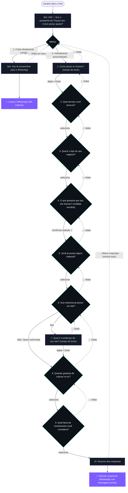

# Fluxo do Assistente — Thauan.dev

Documentação do chat guiado que fica no canto inferior direito do site.

- **Componente:** `components/Assistant.jsx` (client component, montado no `app/layout.jsx`)
- **Dados do fluxo:** `lib/assistant.js`
- **Número de WhatsApp:** `ASSISTANT_NUMBER` em `lib/assistant.js` (fonte única)
- **Persistência:** `localStorage`, chave `thauan.assistant.v1`

O assistente é uma **máquina de estados** (`step`). Cada resposta é acumulada em `answers` e, no final, transformada numa mensagem de WhatsApp por `buildWhatsApp()`.

---

## Fluxograma

Setas cheias = avançar · Setas tracejadas = **← Voltar à etapa anterior**



> Observação: ao voltar da etapa **Prazo** (8), o destino é **Endereço do site** (7) se o usuário respondeu "Sim" em "já possui site"; caso contrário, volta para **Sua empresa já possui um site?** (6).

---

## Opções de cada etapa

### MENU → 2 caminhos
| Opção | Leva para |
|---|---|
| 💬 Falar diretamente comigo | WhatsApp direto (`direct`) |
| ✨ Atendimento personalizado | Pergunta do nome (`name`) |

### 1. Como posso te chamar?
Campo de texto. Ao digitar o nome e pressionar **Enter**, o bot responde *"Prazer, {nome}! 🤝"* e segue para o serviço. O nome é usado para personalizar a conversa e entra na mensagem final do WhatsApp.

### 2. Qual serviço você procura?
Define também **quais tipos de negócio** aparecem na pergunta seguinte.

| Serviço | Tipos de negócio mostrados |
|---|---|
| 🌐 Criar um site | 🍔 Lanchonete/Restaurante · 💈 Barbearia/Salão · 💻 Loja de eletrônicos · 🛠️ Assistência técnica · 🏪 Loja/comércio · 👤 Profissional autônomo · 📦 Outro |
| 🛒 Loja / catálogo online | 👕 Roupas/Moda · 🍫 Alimentos/Doces · 🎁 Artesanato/Presentes · 💻 Eletrônicos · 🏪 Loja/comércio · 📦 Outro |
| 🎨 Design / identidade visual | 🎨 Logo/marca · 🖌️ Identidade visual completa · 📱 Artes para redes sociais · 🎨 Outro |
| 🔧 Manutenção de site | 🔄 Atualizar conteúdo/textos · 🖥️ Mudar o visual/layout · 🐞 Corrigir problema no site · 🔧 Outro |
| ❓ Outro | 💡 Consultoria · ❓ Outro assunto |

### 4. O que gostaria que o site tivesse? (múltipla escolha)
Só avança com **Confirmar seleção ✓**.
📄 Página da empresa · 📦 Catálogo de produtos · 💬 Botão para WhatsApp · 📍 Localização/Maps · 🛒 Carrinho e pedidos · ✨ Ainda não sei

### 5. Já possui material (logo, fotos, textos)?
✅ Já tenho tudo · 🟡 Tenho algumas coisas · ❌ Ainda não tenho nada

### 6. Sua empresa já possui um site?
✅ Sim · ❌ Não · 🔄 Tenho, mas quero reformular
- **Sim** → pede a URL (etapa 7) → depois prazo
- **Não / Reformular** → vai direto ao prazo

### 8. Prazo
⚡ O quanto antes · 📅 Nesta semana · 🗓️ Neste mês · 🤔 Ainda estou pesquisando

### 9. Faixa de investimento
R$ 300–500 · R$ 500–1.000 · R$ 1.000+ · Ainda não sei

### 10. Resumo
Lista todas as respostas + botão **💬 Solicitar orçamento** (abre o WhatsApp com a mensagem já formatada) e **← Alterar respostas** (zera tudo e volta ao MENU).

---

## Comportamentos

- **Personalização:** o nome informado é usado em *"Prazer, {nome}!"* e na mensagem final.
- **Indicador de digitação:** aparece por ~350 ms antes de cada pergunta do bot.
- **← Voltar à etapa anterior:** disponível em todas as etapas do atendimento guiado (não aparece no menu, no WhatsApp direto nem no resumo). Ao voltar, **a resposta da etapa de destino é mantida** e destacada; apenas as etapas seguintes são limpas para serem respondidas de novo.
- **Seleção destacada:** ao revisitar uma etapa, a opção já escolhida aparece realçada (borda/roxo). Vale para serviço, negócio, recursos, material, site atual, prazo e orçamento.
- **Persistência:** `answers`, `step` e o histórico de `messages` são salvos em `localStorage` (chave `thauan.assistant.v1`). Ao recarregar a página ou voltar depois, a conversa continua de onde parou.
- **Esc** fecha o painel do chat.
- **Teclado / leitor de tela:** a área de conversa é um `role="log"` com `aria-live="polite"`.
- Os campos de texto (nome e URL) recebem foco automático ao aparecer.

## O que alimenta a mensagem final

`buildWhatsApp(answers)` monta a mensagem com as respostas marcadas com `📌`:

```
Olá, Thauan!

Vim pelo site e gostaria de solicitar um orçamento.

*Nome:* ...
*Serviço:* ...
*Negócio:* ...
*Recursos:* ... + ...
*Materiais:* ...
*Site atual:* ...
*Prazo:* ...
*Orçamento:* ...
```

> Os rótulos usam `*texto*`, que o WhatsApp renderiza em **negrito**. Emojis "astrais" (4 bytes, como 📌) são evitados porque se corrompem ao passar pelo link `wa.me`.

## Ideias futuras (não implementadas)

- Tratar "Ainda não sei" em **Recursos** como opção exclusiva (deselecionar as demais).
- Reiniciar a conversa pelo cabeçalho do chat, sem precisar chegar ao resumo.
- Analytics: medir quantos chegam ao resumo e clicam no WhatsApp.
- Estimativa de faixa de preço calculada a partir das respostas.
